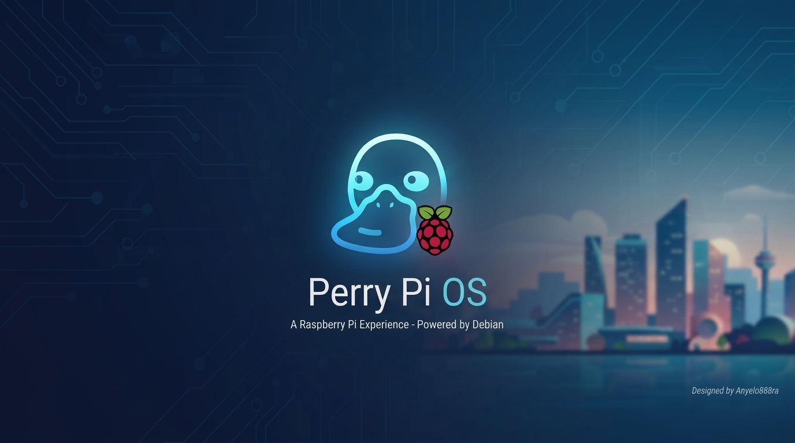
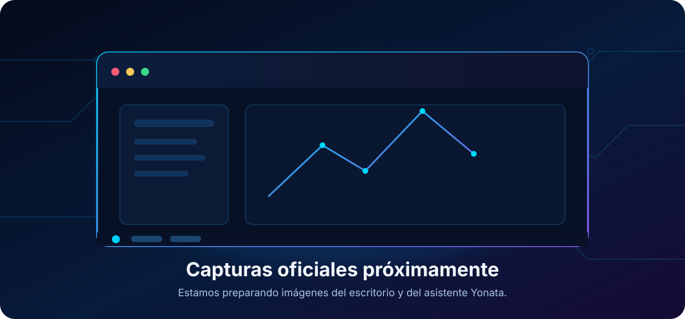

# Perry Pi OS

<p align="center">
  
</p>

<p align="center">
  <strong>Tu espacio para desarrollar en Linux.</strong><br>
  Sistema ligero basado en Debian 12 (Bookworm), con Openbox, Perry Panel y el asistente Yonata.
</p>

<p align="center">
  <a href="https://github.com/anyelo888ra-ux/perry-pi-os/actions/workflows/build-os.yml">
    
  </a>
  <a href="LICENSE"></a>
</p>

## Capturas del escritorio

Las capturas oficiales de Perry Pi OS todavía están en preparación. Esta sección se actualizará cuando estén listas las imágenes del escritorio, el menú Perry y el asistente Yonata.

<p align="center">
  
</p>

## Ediciones

| Edición | Arquitectura | Uso |
|---|---|---|
| **Web** | 32-bit i386 | Imagen de disco para QEMU y pruebas web |
| **Local ISO** | 64-bit amd64 | ISO híbrida para arrancar desde USB o máquina virtual |
| **Normal** | 64-bit amd64 | Imagen de disco instalada |

Las compilaciones se generan mediante GitHub Actions. La descarga más reciente está en [Releases → latest](https://github.com/anyelo888ra-ux/perry-pi-os/releases/tag/latest).

## Escritorio Perry

- **Perry Panel:** menú Inicio, búsqueda de aplicaciones, accesos rápidos, perfil, reloj y controles de sesión.
- **Yonata:** asistente de primer inicio para idioma, teclado, zona horaria, usuario y contraseña.
- **Openbox + Xorg:** escritorio ligero pensado también para equipos modestos.
- **Aplicaciones:** Chromium o NetSurf según edición, PCManFM, LXTerminal, Mousepad, Galculator, Viewnior, htop, Xarchiver y LXAppearance.

## Personalización de fondos

El fondo predeterminado se encuentra en `wallpaper.png`. Los fondos adicionales en formato PNG que se coloquen en `wallpapers/` se copiarán automáticamente a:

`/usr/share/backgrounds/perry-pi-os/`

Después pueden seleccionarse desde **Perry → Fondos de pantalla**. Si la carpeta todavía no contiene fondos adicionales, el selector mostrará un aviso y el sistema conservará el fondo predeterminado.

## Yonata: configuración inicial

En el primer inicio, Yonata permite elegir:

- Español (Venezuela), Español (España), English (US) o English (UK).
- Teclado latinoamericano, español o estadounidense.
- Zona horaria Caracas, Madrid, Nueva York o UTC.
- Nombre de usuario, contraseña y acceso automático opcional.

Al finalizar, configura la sesión personal y revoca los permisos temporales de la cuenta de instalación.

## Probar Perry Pi OS

### Web 32-bit en QEMU

```bash
qemu-system-i386 \
  -m 512M \
  -drive file=perry-pi-os-web.img,format=raw,if=ide \
  -boot c -vga std
```

Para salir de QEMU en modo consola: `Ctrl+A`, suelta y pulsa `X`.

## Compilar desde GitHub

1. Abre **Actions → Compilar Perry Pi OS**.
2. Selecciona **Run workflow**.
3. Espera a que terminen los tres trabajos de compilación.
4. Descarga los artefactos o visita **Releases**.

El workflow también se ejecuta al actualizar `build/**`, `wallpaper.png`, `wallpapers/**` o el propio workflow en `main`.

## Estado del proyecto

Perry Pi OS está en desarrollo. Las imágenes deben probarse en una máquina virtual y en el hardware objetivo antes de usarse como sistema principal. Las ediciones actuales son para **i386 y amd64**; todavía no son imágenes ARM oficiales para Raspberry Pi.

## Contribuir

Las mejoras al escritorio, Yonata, documentación, compatibilidad y aplicaciones son bienvenidas. Consulta los archivos de `build/` y el workflow antes de proponer cambios.
